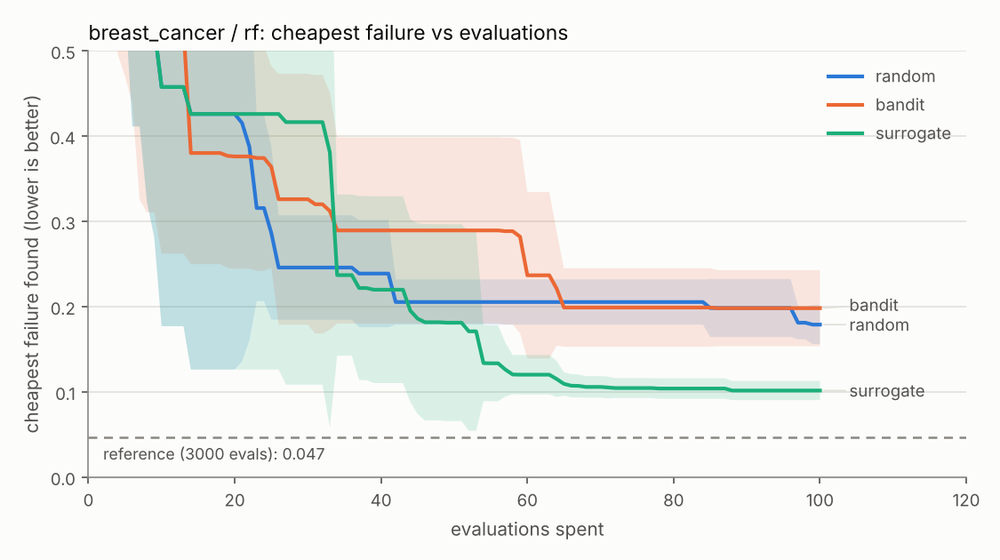
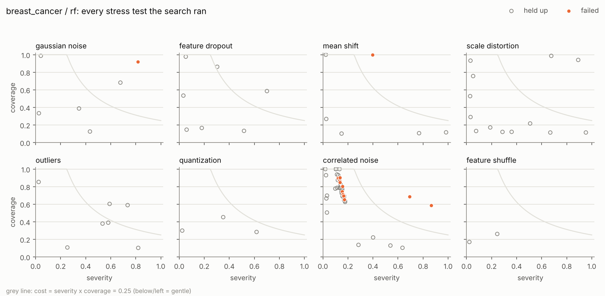
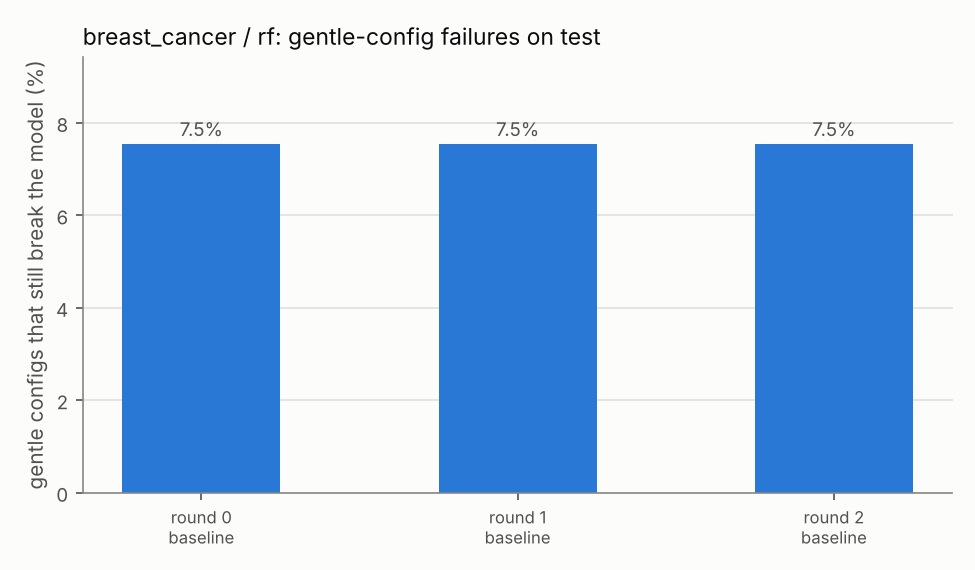
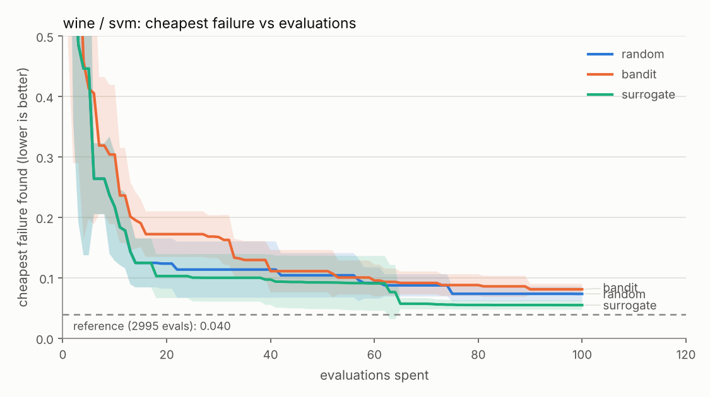
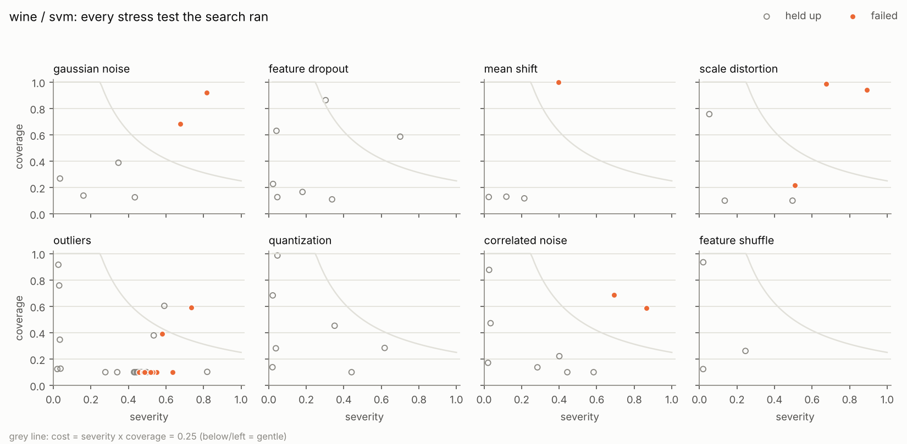
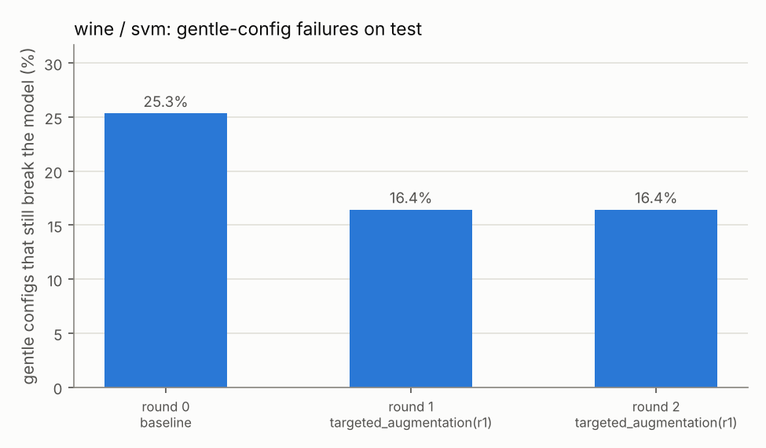

# BreakPoint report

Stress-testing 2 model(s). Failure = accuracy drop >= 10%; search budget 100 evaluations; 5 seeds per strategy; fixes verified on validation and reported on test.

## 1. breast_cancer / rf

Clean accuracy: **93.7%** (test). A config *fails* when it costs at least **10%** accuracy. In a large reference search on the validation split (3000 evals) **17%** of all stress tests break the model; the gentlest failure found costs **0.047** (cost = severity x coverage, 0 = untouched, 1 = everything at maximum).

### Finding failures: strategy comparison

Each strategy gets 100 model evaluations; 5 independent seeds. Lower final cost = a gentler failure discovered.

| strategy | cheapest failure (mean +- sd) | evals to get within 0.05 of reference | failures found | seconds/run |
|---|---|---|---|---|
| random | 0.179 +- 0.023 | 101+ | 18.2 | 0.7 |
| bandit | 0.198 +- 0.045 | 101+ | 28.8 | 0.6 |
| surrogate | 0.101 +- 0.011 | 85+ | 14.4 | 6.5 |

(A `+` means at least one seed never got within 0.05 of the reference inside the budget; those runs count as budget + 1.)

### Where it breaks

Cheapest failures found on the validation split (baseline model):

| cost | accuracy drop | stress test |
|---|---|---|
| 0.108 | 10.6 pts | shared common-mode noise (sigma = 0.36 std) on 90% of features (its least important features) |
| 0.112 | 12.0 pts | shared common-mode noise (sigma = 0.51 std) on 65% of features (the model's most important features) |
| 0.112 | 10.6 pts | shared common-mode noise (sigma = 0.47 std) on 71% of features (the model's most important features) |
| 0.113 | 11.3 pts | shared common-mode noise (sigma = 0.48 std) on 71% of features (the model's most important features) |
| 0.113 | 11.3 pts | shared common-mode noise (sigma = 0.46 std) on 74% of features (the model's most important features) |
| 0.114 | 13.4 pts | shared common-mode noise (sigma = 0.49 std) on 70% of features (the model's most important features) |

Of the 20 cheapest failures: 73% hit important features, 13% hit unimportant features, 13% hit random features.
Most common perturbation families: correlated noise (87%), mean shift (7%), gaussian noise (7%).

### Fixing: propose, verify, accept

Candidate fixes are trained each round and scored on a *validation* gate (failure rate over gentle configs, cost <= 0.25). One is kept only if it clears the gate; otherwise the model is left alone.

**Round 0** (model: baseline)

| candidate | gate failure rate (val) | clean acc (val) | passed gate | kept |
|---|---|---|---|---|
| targeted_augmentation | 3.0% | 95.1% | no | no |
| random_augmentation | 6.0% | 93.0% | no | no |
| feature_subspace | 6.0% | 93.7% | no | no |

No candidate passed the gate (needs >= 2% fewer failures and at most 1.5% clean-accuracy loss on validation); model unchanged.

**Round 1** (model: baseline)

| candidate | gate failure rate (val) | clean acc (val) | passed gate | kept |
|---|---|---|---|---|
| targeted_augmentation | 4.3% | 94.4% | no | no |
| random_augmentation | 4.3% | 95.8% | no | no |
| feature_subspace | 5.7% | 95.8% | no | no |

No candidate passed the gate (needs >= 2% fewer failures and at most 1.5% clean-accuracy loss on validation); model unchanged.

### Result on the untouched test split

| | before | after |
|---|---|---|
| clean accuracy | 93.7% | 93.7% |
| gentle configs (cost <= 0.25) that break the model | 7.5% | 7.5% |
| all battery configs that break the model | 19.6% | 19.6% |
| mean accuracy under the battery | 88.2% | 88.2% |
| cheapest failure found (independent 1800-eval search) | 0.075 | 0.075 |

Final model: **baseline**.

## 2. wine / svm

Clean accuracy: **97.8%** (test). A config *fails* when it costs at least **10%** accuracy. In a large reference search on the validation split (2995 evals) **53%** of all stress tests break the model; the gentlest failure found costs **0.040** (cost = severity x coverage, 0 = untouched, 1 = everything at maximum).

### Finding failures: strategy comparison

Each strategy gets 100 model evaluations; 5 independent seeds. Lower final cost = a gentler failure discovered.

| strategy | cheapest failure (mean +- sd) | evals to get within 0.05 of reference | failures found | seconds/run |
|---|---|---|---|---|
| random | 0.073 +- 0.012 | 35 | 53.0 | 0.1 |
| bandit | 0.081 +- 0.009 | 59+ | 55.2 | 0.1 |
| surrogate | 0.055 +- 0.008 | 34 | 19.4 | 5.6 |

(A `+` means at least one seed never got within 0.05 of the reference inside the budget; those runs count as budget + 1.)

### Where it breaks

Cheapest failures found on the validation split (baseline model):

| cost | accuracy drop | stress test |
|---|---|---|
| 0.046 | 11.4 pts | +/-3.7 std spikes in 20% of rows on 10% of features (the model's most important features) |
| 0.048 | 11.4 pts | +/-3.8 std spikes in 20% of rows on 10% of features (its least important features) |
| 0.048 | 11.4 pts | +/-3.8 std spikes in 20% of rows on 10% of features (the model's most important features) |
| 0.049 | 11.4 pts | +/-3.9 std spikes in 20% of rows on 10% of features (the model's most important features) |
| 0.049 | 11.4 pts | +/-3.9 std spikes in 20% of rows on 10% of features (the model's most important features) |
| 0.052 | 13.6 pts | +/-4.1 std spikes in 20% of rows on 10% of features (the model's most important features) |

Of the 20 cheapest failures: 68% hit important features, 16% hit unimportant features, 16% hit random features.
Most common perturbation families: outliers (58%), scale distortion (16%), gaussian noise (11%).

### Fixing: propose, verify, accept

Candidate fixes are trained each round and scored on a *validation* gate (failure rate over gentle configs, cost <= 0.25). One is kept only if it clears the gate; otherwise the model is left alone.

**Round 0** (model: baseline)

| candidate | gate failure rate (val) | clean acc (val) | passed gate | kept |
|---|---|---|---|---|
| targeted_augmentation | 8.7% | 97.7% | yes | **yes** |
| random_augmentation | 12.3% | 97.7% | yes | no |
| feature_subspace | 21.7% | 100.0% | yes | no |

Accepted targeted_augmentation: gentle-config failure rate on validation 24.3% -> 8.7%.

**Round 1** (model: targeted_augmentation(r1))

| candidate | gate failure rate (val) | clean acc (val) | passed gate | kept |
|---|---|---|---|---|
| targeted_augmentation | 11.0% | 97.7% | no | no |
| random_augmentation | 11.7% | 97.7% | no | no |
| feature_subspace | 12.0% | 95.5% | no | no |

No candidate passed the gate (needs >= 2% fewer failures and at most 2.3% clean-accuracy loss on validation); model unchanged.

### Result on the untouched test split

| | before | after |
|---|---|---|
| clean accuracy | 97.8% | 97.8% |
| gentle configs (cost <= 0.25) that break the model | 25.3% | 16.4% |
| all battery configs that break the model | 48.3% | 39.6% |
| mean accuracy under the battery | 80.9% | 86.0% |
| cheapest failure found (independent 1800-eval search) | 0.023 | 0.044 |

Final model: **targeted_augmentation(r1)**.

## Limitations

- **Cost is a design choice.** Severity is normalized per perturbation family, so a cost of 0.1 in one family is not physically equivalent to 0.1 in another. Compare costs within a family, or across families only as a rough ordering.
- **'Important' features are model-relative.** Targeted configs hit whichever features the *current* model relies on most, so after a fix the same config attacks different features. That is intended (an adaptive attacker would do the same) but it means before/after numbers compare against a moving target.
- **Small splits are noisy.** With a few hundred rows, one sample is a fraction of a point; differences of 1-3 points are within noise. The accept gate is tolerant of one validation sample for that reason.
- **The reference is a bound, not the truth.** Its cheapest failure is the best of a finite search; a strategy can beat it. The breakpoint is a minimum over what was searched, so it can shift between search seeds on the *same* model.
- **Search seeds matter.** Re-running the search on an unchanged model gave cheapest failures that differed by roughly 0.01-0.04 in our runs. Treat a single breakpoint number as an estimate and use the gentle-config failure rate for before/after claims.
- **Tabular classifiers only.** Perturbations act on standardized numeric features.
