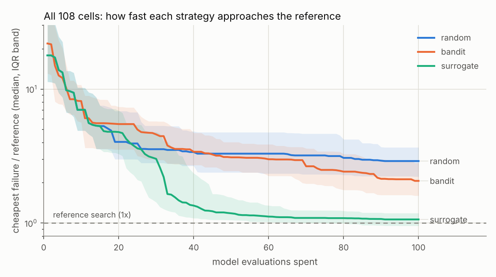
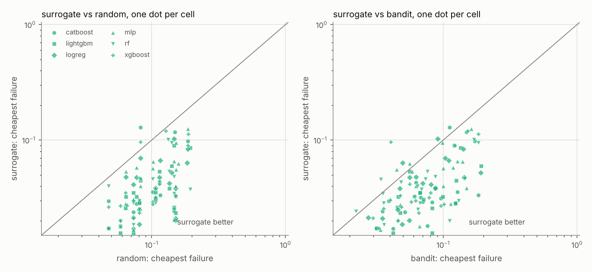
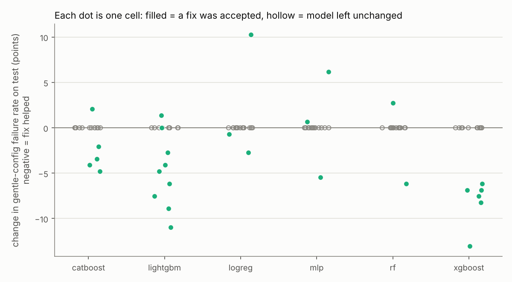

# BreakPoint: multi-seed benchmark

**108 cells** = 6 models x 6 datasets x 3 seeds (models: catboost, lightgbm, logreg, mlp, rf, xgboost; datasets: breast_cancer, digits, multiclass, nonlinear, synthetic_large, wine). 0 cell(s) failed to run.

Search budget 100 evaluations per strategy per cell; failure = accuracy drop >= 10%. The seed changes the split, the model's init and the search RNG (synthetic datasets themselves are fixed). Every number below is a paired comparison within a cell.

## 1. Finding failures: does the surrogate search find gentler ones?

108 of 108 cells contain failures to find.

| surrogate vs | cheapest failure ratio (geo-mean) | surrogate wins / ties / losses |
|---|---|---|
| random | **0.38** (95% CI 0.35 to 0.42) | 106 / 0 / 2 |
| bandit | **0.52** (95% CI 0.48 to 0.57) | 100 / 0 / 8 |

Per-seed geometric-mean ratio, surrogate vs random: seed 0: 0.46, seed 1: 0.34, seed 2: 0.36. Vs bandit: seed 0: 0.40, seed 1: 0.67, seed 2: 0.54. (The random strategy draws the same configs in every cell that shares a seed, so the number of *independent* random draws is the number of seeds; read the per-seed ratios as the conservative view and the confidence intervals above as optimistic.)

A ratio below 1 means the surrogate's cheapest failure costs less (it found a gentler failure). For reference, bandit vs random: ratio 0.73 (95% CI 0.66 to 0.81), bandit wins/ties/losses 74 / 2 / 32.

| strategy | median cheapest failure | cells with no failure found | failing configs found (mean) | seconds per search |
|---|---|---|---|---|
| random | 0.101 | 0 | 37.7 | 0.8 |
| bandit | 0.068 | 0 | 44.5 | 0.8 |
| surrogate | 0.035 | 0 | 19.7 | 6.8 |

Surrogate / random ratio by model and by dataset (below 1 = surrogate found a gentler failure):

| model | cells | ratio | wins |
|---|---|---|---|
| catboost | 18 | 0.37 | 17/18 |
| lightgbm | 18 | 0.35 | 18/18 |
| logreg | 18 | 0.38 | 18/18 |
| mlp | 18 | 0.43 | 18/18 |
| rf | 18 | 0.38 | 18/18 |
| xgboost | 18 | 0.40 | 17/18 |

| dataset | cells | ratio | wins |
|---|---|---|---|
| breast_cancer | 18 | 0.54 | 18/18 |
| digits | 18 | 0.49 | 18/18 |
| multiclass | 18 | 0.35 | 18/18 |
| nonlinear | 18 | 0.26 | 18/18 |
| synthetic_large | 18 | 0.27 | 18/18 |
| wine | 18 | 0.49 | 16/18 |

## 2. Fixing: does propose-verify-accept help on held-out test data?

Cells with headroom (at least 5% of gentle test configs break the baseline): **107 of 108**. A fix was accepted in **28** cells (27 of them with headroom). Accepted fixes: targeted_augmentation x20, random_augmentation x7, feature_subspace x1.

| change in gentle-config failure rate on test | mean |
|---|---|
| all cells (unchanged models count as 0) | -0.9 pts (95% CI -1.5 to -0.4) |
| cells with headroom | -1.0 pts (95% CI -1.5 to -0.4) |
| cells where a fix was accepted | -3.6 pts (95% CI -5.3 to -1.7) |
| clean accuracy, accepted cells | -0.1 pts (95% CI -0.6 to +0.4) |

Of the 28 accepted fixes, **21 reduced** gentle-config failures on test, **6 increased** them, 1 were unchanged. The gate sees only validation data, so accepted fixes that get worse on test are the price of small validation sets.

Targeted vs blind random augmentation, same data volume, on the validation gate (108 cells where both were tried): targeted lower in 54, tied in 11, higher in 43.

| model | cells | with headroom | fix accepted | mean change, all (pts) | mean change, headroom (pts) |
|---|---|---|---|---|---|
| catboost | 18 | 18 | 5 | -0.7 | -0.7 |
| lightgbm | 18 | 18 | 9 | -2.4 | -2.4 |
| logreg | 18 | 18 | 3 | +0.4 | +0.4 |
| mlp | 18 | 18 | 3 | +0.1 | +0.1 |
| rf | 18 | 17 | 2 | -0.2 | -0.4 |
| xgboost | 18 | 18 | 6 | -2.7 | -2.7 |

## Caveats

- Cells are not independent samples of 'all ML problems': they share datasets and models, and the synthetic datasets are fixed across seeds. Confidence intervals bootstrap over cells, so they describe this grid, not a population of real-world tasks.
- Cost (severity x coverage) is not comparable across perturbation families; ratios are within a cell.
- All data here is built-in or synthetic. Run `python -m breakpoint_ml run --csv ... --target ...` on real data before claiming anything beyond this grid.
